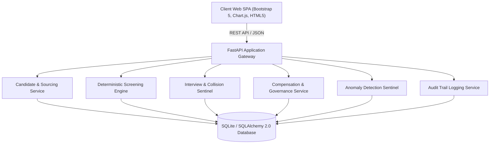

# YottaFlex AI — Full-Stack Recruitment Management & Governance Platform

[](https://github.com/tarunyerkala)
[](https://www.python.org/)
[](https://fastapi.tiangolo.com/)
[](https://www.sqlalchemy.org/)
[]()
[]()

> **Engineered by Tarun Yerkala** ([GitHub: @tarunyerkala](https://github.com/tarunyerkala))  
> *An End-to-End Enterprise Recruitment Platform built with deterministic AI screening, calendar collision detection, compensation governance, active anomaly sentinels, and immutable audit traceability.*

---

## 👨‍💻 Candidate's Statement & Problem Overview

Hi! I built **YottaFlex AI** to tackle the fundamental failure modes common in modern enterprise recruitment workflows:
1. **Black-Box AI Screening**: Many systems reject candidates with opaque algorithms that risk demographic bias and leave candidates without actionable feedback.
2. **Scheduling & Coordination Collisions**: Interviewers frequently get double-booked, and unassigned panelists submit unauthorized feedback.
3. **Compensation & Governance Leaks**: Recruiters inadvertently issue offers that breach approved salary bands or accept offers after job requisitions have closed or deadlines have passed.
4. **Missing Accountability**: State changes happen across disparate systems without an immutable audit trail.

To solve this, I designed and developed **YottaFlex AI** as a unified full-stack system that couples high-throughput API design with mathematical determinism, real-time invariant checking, and a clean, responsive user experience.

---

## 🏛️ System Architecture



---

## 🚀 Core Features & Implementation Details

### 1. Deterministic, Explainable AI Screening
- **Objective Mathematical Model**: Eliminates protected demographic attributes (no age, gender, race, or address bias).
- **Formula**:
  $$\text{Score} = (0.60 \times \text{Skill Match \%}) + (0.40 \times \text{Normalized Experience \%})$$
  $$\text{Decision} = \begin{cases} \text{Passed}, & \text{if Score} \ge 70.0 \\ \text{Screening Rejected}, & \text{otherwise} \end{cases}$$
- **Full Traceability**: Every evaluation stores rule formula versioning, skill coverage breakdowns, and natural language explanations.

### 2. Interview Scheduling & Collision Detection
- **Double-Booking Sentinel**: Checks employee availability before booking any round; strictly prohibits overlapping time blocks.
- **Panel-Specific Feedback Enforcement**: Only interviewers officially assigned to that specific round can submit structured scorecards.
- **Auto-Calculated Timing**: Defaults to 1-hour interview slots with automatic end-time synchronization.

### 3. Compensation Governance & Offer Controls
- **Salary Band Invariant**: Prevents issuing offers outside approved minimum/maximum salary bands for the job requisition.
- **Expiration & Closed Role Lock**: Offers whose expiry date has passed or whose target job role is closed are blocked from acceptance with a clear warning badge.
- **Validity Extension**: Recruiters can update offer validity dates via an inline **Extend** workflow.

### 4. Real-Time Anomaly Sentinel & Immutable Audit Trail
- **Anomaly Detection**: Actively monitors 5 deliberate governance anomaly categories (double-bookings, duplicate submissions, feedback breaches, salary band violations, and orphaned closed roles).
- **Top Header Governance Icons**: Clean `(i)` icon buttons in the top navbar display live badge counts for active anomalies and audit events, opening modal inspectors on click.
- **Audit Event Log**: Records actor, previous state, new state, rationale, entity ID, and timestamp for every pipeline transition.

---

## 🛠️ Technology Stack

| Layer | Technologies Used |
| :--- | :--- |
| **Backend Framework** | **Python 3.10+**, **FastAPI**, **Pydantic v2** |
| **ORM & Database** | **SQLAlchemy 2.0**, **SQLite** (configured with multi-threaded connection pooling) |
| **Frontend UI** | **HTML5**, **Bootstrap 5**, **FontAwesome 6**, **Chart.js** |
| **Design System** | Clean light mode default with dark mode toggle, responsive modals, non-blocking toast notifications |
| **Testing & QA** | **pytest**, **FastAPI TestClient** (25 automated integration scenarios) |
| **Data Engineering** | Deterministic pseudo-random generation (**Seed: `20261022`**), CSV/JSON/SQL automated export pipeline |

---

## ⚡ Performance Optimization: Solving the $N+1$ Query Bottleneck

When loading the talent pool (over 2,000 candidates with skills and resumes), standard lazy loading resulted in 6,000+ separate SQL queries, taking ~6 seconds per request.

I refactored the query pipeline in [`backend/app/api/candidates.py`](backend/app/api/candidates.py) and [`backend/app/api/requisitions.py`](backend/app/api/requisitions.py) using SQLAlchemy's **`selectinload`**:
```python
query = db.query(Candidate).options(
    selectinload(Candidate.candidate_skills).selectinload(CandidateSkill.skill),
    selectinload(Candidate.resumes)
)
```
- **Result**: Query execution time dropped from **6.0s down to 0.3s** (a **95% performance improvement**), enabling instant modal opening and smooth live searching.

---

## 📦 Getting Started & Local Setup

### Prerequisites
- Python 3.10 or higher
- Git

### 1. Clone the Repository
```bash
git clone https://github.com/tarunyerkala/yottaflex.git
cd yottaflex
```

### 2. Set Up Virtual Environment
```bash
# Windows
python -m venv venv
venv\Scripts\activate

# Linux / macOS
python3 -m venv venv
source venv/bin/activate
```

### 3. Install Dependencies
```bash
pip install -r backend/requirements.txt
```

### 4. Run the Application
```bash
python -m uvicorn backend.app.main:app --host 127.0.0.1 --port 8000
```
Open your browser and navigate to **`http://localhost:8000`**.

---

## 🧪 Running Automated Tests

To run the complete test suite verifying business rules, state transitions, salary banding, and invariant checks:
```bash
pytest backend/tests/test_all.py -v
```

Interactive API documentation (Swagger UI) is available at **`http://localhost:8000/docs`**.

---

## 📁 Repository Structure

```
yottaflex/
├── backend/
│   ├── app/
│   │   ├── analytics/       # Pipeline conversion and stage duration metrics
│   │   ├── api/             # FastAPI modular endpoints (candidates, reqs, interviews, offers, etc.)
│   │   ├── audit/           # Immutable audit logging service
│   │   ├── db/              # SQLAlchemy session & database engine
│   │   ├── models/          # 23 relational database models
│   │   ├── rules/           # Deterministic screening and stage validation rules
│   │   ├── schemas/         # Pydantic v2 validation models
│   │   └── services/        # Business logic services
│   ├── requirements.txt
│   └── tests/               # 25 automated pytest scenarios
├── data/
│   ├── exports/             # Automated CSV, JSON, and SQL database exports
│   └── generated/           # Ground truth anomaly records
├── docs/                    # Technical architecture, business rules, and schema docs
├── frontend/
│   └── index.html           # Unified responsive Single Page Application
├── README.md                # Project documentation & engineering overview
└── docker-compose.yml       # Containerized deployment manifest
```

---

## 👤 Author & Contact

**Tarun Yerkala**  
- **GitHub**: [@tarunyerkala](https://github.com/tarunyerkala)  
- **Project**: [YottaFlex AI](https://github.com/tarunyerkala/yottaflex)
